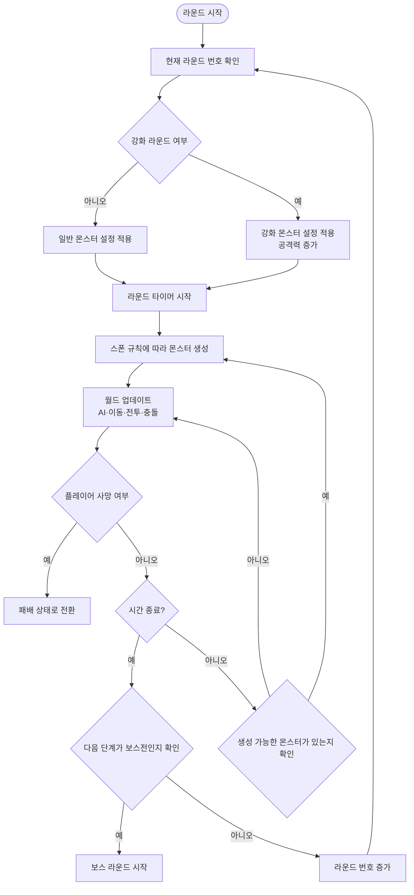

# Building Survival 게임 기획서
- 작성자: 홍성찬
- 작성일: 2026.10.18
- 수정일: 
- 수정일:

## 개요
- 제목: **Building Survival**
- 부제: **구조를 기다리며 다가오는 몬스터로부터 살아남아라**
- 장르: 2D 탑다운-서바이벌 액션
- 핵심 특징: 제한된 구역에서 지형을 활용해 몰려오는 몬스터를 제거해야 한다.
- 분위기: 쯔꾸르풍 2D 액션 게임
- 참고 작품: 좀비고등학교
---

## 시스템 기획 내용
### 플레이 방식
#### 게임 흐름


#### 플레이어 이동
| 키 | 동작 |
|---|---|
| W | y좌표 증가 |
| A | X좌표 감소 |
| S | y좌표 감소 |
| D | X좌표 증가 |
| 마우스 우클릭 | 공격 |
| ... | 추가 동작 키 추가 예정 |

### 스테이지 구성
#### 1. 약화 스테이지: 플레이어에 비해 상당히 약한 몬스터가 등장한다.
- 플레이어의 피로도를 낮추기 위해 존재한다.
#### 2. 일반 스테이지: 플레이어와 대등하거나 약한 몬스터가 등장한다.
#### 3. 강화 스테이지: 플레이어보다 강한 몬스터가 등장한다.
- 플레이어는 강화된 무기를 사용하여 몬스터를 처리해야 한다.

### UI 구성
#### 1. 플레이어
- 플레이어의 스태미나와 체력은 플레이 화면 왼쪽 하단에 위치한다. 
- 사용 가능한 아이템은 화면 오른쪽 중간에 위치한다.
- 인벤토리는 특정 키를 통해 열 수 있다.
#### 2. BOSS
- 보스의 체력은 화면 최상단에 위치한다.

### 주요 클래스 디자인
| 클래스 이름 | 설명 |
|---|---|
| Scene | 맵과 게임 오브젝트의 생명주기 관리 |
| Entity | 위치, 이동, 체력 등 공통 요소 |
| Player | 플레이어 관련 로직 처리 |
| Monster | 몹 관련 로직 처리 |
| BOSS | 보스 관련 로직 처리 |
| CollisionSystem | 충돌 검사 |
| CombatSystem | 공격 판정과 피해 계산 |
| Camera | 월드 좌표와 화면 좌표 계산 |
| UIManager | 게임 내부 UI 관리 |

### 플레이어 및 적대 엔티티
#### 1. 공통 요소
- CombatSystem: 동일한 전투 로직을 사용
- CollisionSystem: 동일한 충돌 로직을 사용

- 애니메이션
    * Idle: 정지 상태
    * Run: 움직이는 상태
    * Die: 사망 상태

- 공통 스탯 항목

| 스탯 | 설명 |
|---|---|
| MaxHP / HP | 최대 체력 / 현재 체력 |
| ATK | 기본 공격력 |
| DEF | 받는 피해 감소량 |
| MoveSpeed | 이동 속도 (픽셀/초) |
| AttackSpeed | 초당 공격 횟수 |
| CritRate | 치명타 확률 (%) |
| CritDamage | 치명타 피해 배율 |
| KnockbackResist | 넉백 저항 (0 ~ 1) |

#### 2. 플레이어
##### 2-1. 플레이어 상태 머신
- 플레이어 상태 머신
    * Idle (대기): 입력이 없는 정지 상태, 스태미나 자연 회복
    * Run (이동): WASD 입력 시 이동, Shift 입력 시 달리기로 전환하며 스태미나 소모
    * Attack (공격): 플레이어가 바라보는 방향으로 공격, 장착 무기에 따라 근거리/원거리 판정 선택
    * Dodge (회피): Space 입력 시 이동 방향으로 구르기, 진행 중 무적 판정
    * Hit (피격): 피해를 받으면 넉백과 짧은 경직, 0.5초 피격 무적 부여
    * Die (사망): HP가 0 이하가 되면 진입, 패배 상태로 전환
##### 2-2. 스태미나 시스템
| 행동 | 스태미나 |
|---|---|
| 달리기 | 초당 20 소모 |
| 회피 구르기 | 회당 25 소모 |
| 근접 공격 | 회당 5 소모 |
| 자연 회복 | 행동 종료 1초 후부터 초당 15 회복 |
#### 3. 적대 엔티티
##### 3-1. 몬스터 종류
| 몬스터 | 공격 유형 | HP | ATK | 이동속도 | 특징 |
|---|---|---|---|---|---|
| 좀비 | 근거리 | 30 | 8 | 80 | 기본 몬스터, 무리 지어 등장 |
| 러너 | 근거리 | 20 | 6 | 160 | 빠른 이동, 낮은 체력 |
| 브루트 | 범위 | 120 | 20 | 50 | 높은 체력, 바리케이드 파괴 특화 |

##### 3-2. AI 상태 머신
- AI 상태 머신
    * Idle (대기): 제자리 순찰, 플레이어 탐색 범위 체크
    * Chase(추적): 일정 거리 내 진입 시 플레이어 추격, 이탈 거리 설정
    * Attack (공격): 근거리, 원거리, 범위 공격 선택 로직
    * Groggy / Down (그로기/무력화): 특정 조건 만족 시 행동 불능 상태 빠지기

### 카메라 시스템 설계
플레이어를 중심으로 화면을 이동시키기 위해 월드 좌표와 화면 좌표를 별도로 계산시키는 과정이 필요하다.

변환에 사용하는 값:

- W: 월드 좌표
- C: 카메라 위치
- Vw: 뷰포트 너비
- Vh: 뷰포트 높이

월드 좌표를 화면 좌표로 변환한다.

```text
ScreenX = WorldX - CameraX + ViewWidth / 2
ScreenY = WorldY - CameraY + ViewHeight / 2
```

화면 좌표를 월드 좌표로 변환한다.

```text
WorldX = ScreenX + CameraX - ViewWidth / 2
WorldY = ScreenY + CameraY - ViewHeight / 2
```

#### 필수 함수
- WorldToScreen(): 월드 좌표를 화면 좌표로 변환
- ScreenToWorld(): 화면 좌표를 월드 좌표로 변환
- CameraLerp(): 카메라의 이동을 부드럽게 연결

### 구현 목표
- 엔티티 충돌 구현
- 플레이어 이동에 따른 카메라 이동(월드 좌표와 화면 좌표 상호변환)
- 몬스터 상태 머신 구현
- 무기 시스템 구현
- 상태에 따른 간단한 애니메이션 추가